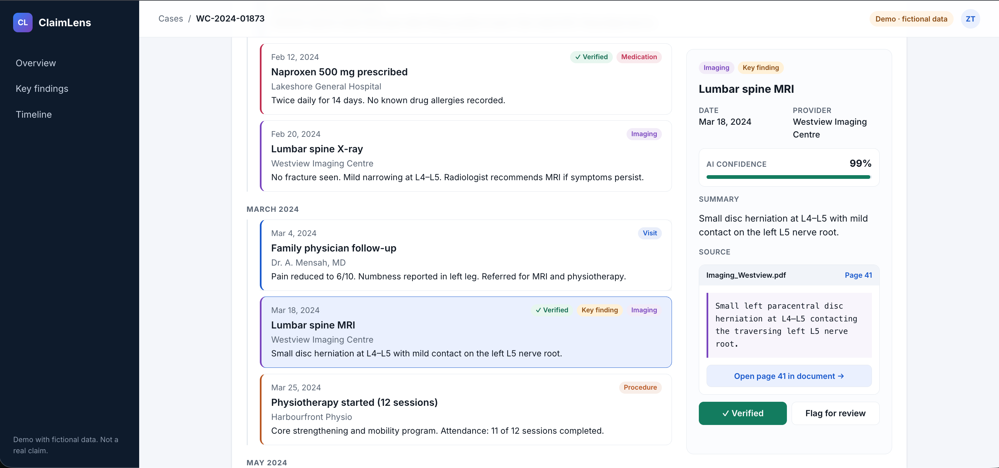

# ClaimLens

ClaimLens is a small claims review tool I built to learn what it takes to review medical records for an insurance claim. It turns a claimant's records into a timeline you can search and filter, lets you verify or flag each event, and opens the original document at the exact page an event came from.

**Live demo:** _coming soon_

> Everything in this project is made up. The claimant, providers and documents are fictional.



## Why I built it

I wanted to understand the problems claims reviewers deal with. A single claim can mean hundreds of pages of medical records. Even when AI pulls out the important events, someone still has to check each one against the source before they can trust it. I wanted to build the screen that person would use.

## What it does

You start with an overview of the case: who the claimant is, how many pages were reviewed, and a few key findings worth looking at first. Below that is the medical chronology, grouped by month. You can search it (matches are highlighted), filter by event type or year, and click any event to see its details.

Each event shows how confident the AI was about it. Anything under 80% gets a warning to double-check the source. From there you can mark the event as verified or flag it for review, and a progress bar keeps track of how far through the case you are.

If you want to see where an event came from, you can open the source PDF. It jumps straight to the cited page and highlights the exact text.

## Running it locally

```bash
git clone https://github.com/zubiatahseen1/claimlens.git
cd claimlens
npm install
npm run dev
```

| Command            | What it does                          |
| ------------------ | ------------------------------------- |
| `npm run dev`      | Starts the dev server                 |
| `npm run test`     | Runs the tests in watch mode          |
| `npm run test:run` | Runs all the tests once               |
| `npm run build`    | Type-checks and builds for production |

If you want to see how it handles a big file, add `?events=5000` to the URL.

**Built with:** React 19, TypeScript, Vite, Mock Service Worker, react-pdf, Vitest and React Testing Library.

## How I approached it

### Treating it like it has a real backend

I didn't want to just import a JSON file, because that skips the parts of front-end work that actually go wrong: slow responses, failed requests and saving data. So the app talks to a small REST API that I mocked with Mock Service Worker. The browser makes real requests, the responses have a delay, and errors come back as real error codes. All of the network code is in one file (`src/api/client.ts`), so swapping in a real backend later would be a small change.

### Making the review buttons feel instant

When you verify or flag something, the screen updates right away and the save happens in the background. If the save fails, the status goes back to what it was and you see a message explaining what happened. I wanted reviewers to get instant feedback, but never be left thinking something was saved when it wasn't.

### Making it fast with thousands of events

Ten events is easy. Real claim files can have thousands. I wrote a small generator that creates a 5,000-event file, measured the app with it, and it was slow. Typing in the search box could freeze the page for over a second.

| With 5,000 events                 | Before   | After |
| --------------------------------- | -------- | ----- |
| Elements on the page              | 50,691   | 1,176 |
| Delay when typing in search (INP) | 1,592 ms | 64 ms |

Four changes made the difference. The timeline now shows 50 events at a time with a "Show more" button. Search uses React's `useDeferredValue`, so typing stays smooth while filtering happens in the background. The timeline is wrapped in `React.memo`, so it doesn't re-render when nothing changed. And the CSS uses `content-visibility: auto`, so the browser skips cards that are off-screen.

### Highlighting the source in the PDF

This was one of my favourite parts. PDF.js is big (around 650 kB), so the viewer only loads the first time someone opens a document. Highlighting the cited text was harder than I expected, because PDFs often split a sentence into lots of separate pieces, sometimes one per word. I ended up collecting the page's text pieces and looking for the run of pieces that spells out the excerpt when you ignore spaces. That logic lives in its own small function, so it was easy to test.

## Testing

Honestly, testing turned out to be the part I enjoyed most. There are 24 tests across 5 files, written with Vitest and React Testing Library. They use the same mock API as the app, so they test the real flow from request to screen, not a fake version of it.

Some of the things they check:

- the loading screen appears, and the app recovers when you hit "Try again" after an error
- search and filters show the right events
- verifying an event updates the progress bar
- if the server fails to save, the status rolls back and an error message appears
- the timeline loads more events in pages
- the PDF viewer opens on the cited page and lets you page back and forth

Writing tests for things going wrong, like a save failing on the server, taught me a lot about what the app actually needs to handle.

## Where things live

```
src/
├── api/client.ts          # every network request
├── components/            # Sidebar, Filters, Timeline, EventDetail, SourceViewer, Highlight
├── data/events.ts         # the fictional records
├── hooks/useCaseData.ts   # loading, errors and saving
├── mocks/                 # mock API, in-memory data and the big-file generator
├── test/setup.ts          # test setup
├── types.ts
└── utils.ts               # formatting and filtering
```

## If I had another week

- Build a real backend so reviews are actually saved
- Add user login, so each review is tied to a reviewer
- Show the timeline and the source document side by side
- Add keyboard shortcuts for reviewers, like `V` to verify and `F` to flag
- Do a proper accessibility review with screen readers. I've covered the basics (keyboard navigation, focus states, labels and announcements), but I'd like to test it with real assistive technology.
